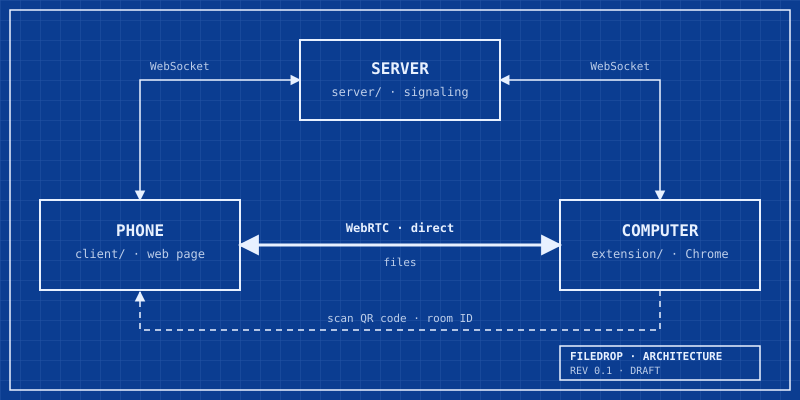

# filedrop

Send photos and files from your phone to your computer's Chrome browser, peer to peer.

> **Status:** work in progress.

## How it works

1. Open the Chrome extension on your computer and scan its QR code with your phone.
2. A small signaling server connects the two devices.
3. Files then go directly from phone to computer over WebRTC.

## Structure

- `server/` signaling server (Node.js, WebSocket)
- `extension/` Chrome extension with QR code
- `client/` web page that opens on the phone

## License

To be decided.